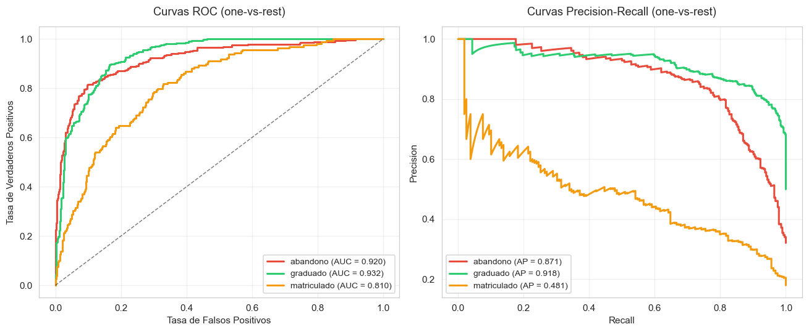
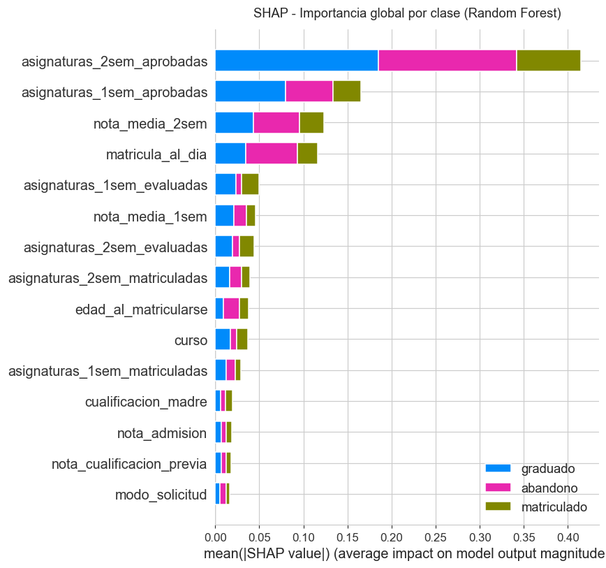
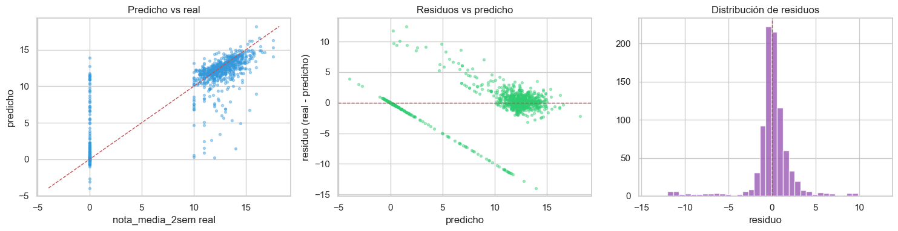
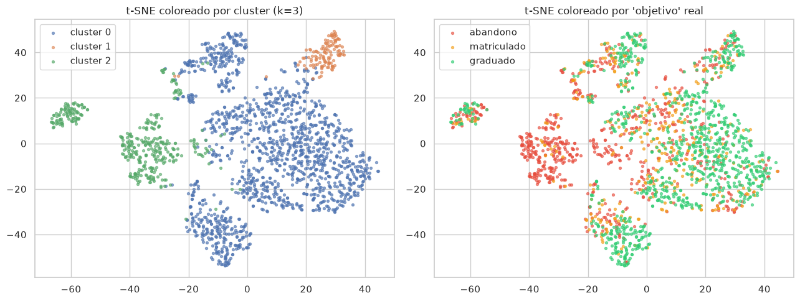

# Proyecto final de Machine Learning

Predicción del éxito académico en educación superior. En este proyecto trabajo con un dataset de 4.424 estudiantes y 37 variables (demográficas, de acceso, socioeconómicas, macroeconómicas y de rendimiento por semestre) y planteo tres tareas complementarias sobre los mismos datos. La primera es una clasificación multiclase de la situación final del estudiante (`abandono`, `matriculado`, `graduado`). La segunda, una regresión de la nota media del 2º semestre (`nota_media_2sem`), cuidando que no se cuele información del propio semestre como predictor. Y la tercera, un clustering descriptivo para encontrar perfiles de trayectoria académica.

Autora: Pilar Pérez Hernández. Aprendizaje Automático, 2º IMAT B, ICAI – Universidad Pontificia Comillas, curso 2025/2026.

*[English version](README.md)*


## Resultados principales

Los números completos están en `memoria.pdf`; aquí dejo solo los que resumen cada tarea.

- **Clasificación** (Gradient Boosting afinado, test): F1 macro **0,693**, accuracy 0,767, F1 weighted 0,758. El baseline trivial que siempre predice "graduado" se queda en F1 macro 0,22. "Matriculado" es la clase difícil (F1 0,44, AP 0,45 frente a ~0,9 en las otras dos).
- **Regresión** (Random Forest afinado, test): RMSE **2,69** frente a 5,20 del `DummyRegressor` (reducción del 48 %), MAE 1,46, R^2 0,73, usando solo información disponible al cierre del 1.er semestre.
- **Clustering** (KMeans sobre PCA al 90 %, k=3): silueta **0,39**, ARI frente a Ward **0,89**, ARI bootstrap medio **0,91** (mín. 0,77). Tres perfiles: riesgo/abandono masivo (n=856, 82 % de abandono), rendimiento medio (n=3289) y rendimiento alto con mayor edad (n=279).

Las mismas variables mandan en las tres tareas: asignaturas aprobadas y nota media del 1.er semestre, nota de admisión, matrícula al día, deudor y edad al matricularse.

<p align="center">
  
</p>
<p align="center">
  
</p>
<p align="center">
  
</p>
<p align="center">
  
</p>


## Contenido de la carpeta

```
.
├── 01_EDA_final.ipynb              EDA y decisiones que condicionan el resto
├── 02_Clasificacion_final.ipynb    Tarea 1: clasificación multiclase
├── 03_Regresion_final.ipynb        Tarea 2: regresión de nota_media_2sem
├── 04_No_supervisado_final.ipynb   Tarea 3: clustering + PCA + t-SNE
├── rendimiento_estudiantes.csv     Datos (separador `;`)
├── memoria.pdf                     Informe en formato NeurIPS, 8 paginas max
├── figures/                        Figuras extraídas de los notebooks para este README
├── README.md                       Versión en inglés
└── README.es.md                    Este archivo
```


## Cómo reproducir los resultados

Los notebooks no se encadenan entre sí porque no hay artefactos intermedios que pasar de uno a otro, pero sí conviene leerlos en orden. La razón es que muchas de las decisiones que aplico en los modelos (qué variables excluyo, qué métrica uso, por qué k=3 en clustering) las argumento primero en el EDA y luego las doy por hechas en los demás notebooks.

El primero, `01_EDA_final.ipynb`, mira la distribución del target, las correlaciones, la asociación entre variables categóricas con Cramér's V y las tasas de abandono por titulación. Aquí es donde justifico todas las decisiones que vienen después. El segundo, `02_Clasificacion_final.ipynb`, compara ocho modelos base con CV-5, prueba estrategias de desbalanceo (`class_weight='balanced'` y SMOTENC), afina Random Forest y Gradient Boosting con `GridSearchCV`, evalúa en test (accuracy, F1 macro, F1 weighted, ROC y PR one-vs-rest), dibuja curvas de aprendizaje y analiza la importancia de variables con Gini, permutation importance y SHAP. El tercero, `03_Regresion_final.ipynb`, repite el esquema sobre `nota_media_2sem` excluyendo todas las variables del 2º semestre como predictoras (control de leakage), reporta RMSE, MAE y R^2, desglosa las métricas por régimen del target (concentración en 0 frente a nube continua entre 10 y 18) y termina con residuos, curvas de aprendizaje, importancias y SHAP. Y el cuarto, `04_No_supervisado_final.ipynb`, hace clustering sobre PCA al 90 % de varianza, compara KMeans y Ward para `k=3`, mide la estabilidad con bootstrap (20 resamples al 80 %), visualiza con t-SNE y compara con la variante `k=2`.

Cada notebook se puede ejecutar entero con "Restart & Run All" sin depender del resto. Todos fijan `SEED = 42`, así que los resultados deberían reproducirse fielmente.

Para reejecutar los cuatro notebooks desde la terminal sin abrir Jupyter:

```bash
jupyter nbconvert --to notebook --execute 01_EDA_final.ipynb           --ExecutePreprocessor.timeout=600
jupyter nbconvert --to notebook --execute 02_Clasificacion_final.ipynb --ExecutePreprocessor.timeout=2400
jupyter nbconvert --to notebook --execute 03_Regresion_final.ipynb     --ExecutePreprocessor.timeout=1200
jupyter nbconvert --to notebook --execute 04_No_supervisado_final.ipynb --ExecutePreprocessor.timeout=600
```


## Dependencias

Probado con Python 3.10. Las versiones de referencia que tengo en mi entorno son las siguientes:

```
pandas   >= 1.5
numpy    >= 1.23
matplotlib >= 3.6
seaborn  >= 0.12
scikit-learn >= 1.3
scipy    >= 1.10
imbalanced-learn >= 0.11   # para SMOTENC en el notebook 02
shap     >= 0.44           # para los SHAP summary plots de 02 y 03
```

Si se quiere instalar todo de una vez:

```bash
pip install pandas numpy matplotlib seaborn scikit-learn scipy imbalanced-learn shap
```

He envuelto las llamadas a `imblearn` y a `shap` en un `try/except ImportError`, así que si alguna de las dos librerías no está disponible los notebooks detectan el caso y se saltan esas celdas sin romper nada.


## Datos

El CSV (`rendimiento_estudiantes.csv`) tiene que estar en la misma carpeta que los notebooks. Se lee con `pd.read_csv(..., sep=';')` porque el separador no es la coma, y consta de 4.424 filas, 37 columnas, sin nulos ni duplicados. El target `objetivo` se reparte entre graduado (49,9 %), abandono (32,1 %) y matriculado (17,9 %), un desbalanceo moderado pero suficiente como para tenerlo presente en la elección de métrica.

El fichero ya viene con las variables categóricas traducidas a etiquetas legibles, así que columnas como `ocupacion_madre`, `nacionalidad` o `cualificacion_previa` son texto y no códigos numéricos. Eso ahorra un paso de recodificación pero también obliga a vigilar el número de niveles de algunas categóricas (`curso` tiene 17 valores y `ocupacion_madre` llega a 31), porque al pasarlas a one-hot inflan rápidamente la dimensión.


## Tiempos de ejecución aproximados

En un portátil moderno con CPU normal, los tiempos que veo son los siguientes. El EDA tarda entre uno y dos minutos, sobre todo por los pairplots y la matriz de correlación. La clasificación es la más cara, entre cinco y diez minutos, y casi todo el tiempo se va en el `GridSearchCV` de RF y GB y en la permutation importance. La regresión queda en tres a cinco minutos. Y el no supervisado se mueve en dos o tres minutos, donde t-SNE es lo que más tarda.


## Reproducibilidad y control de leakage

He intentado dejar todo lo estocástico controlado por la misma semilla, `SEED = 42`, que se aplica a los splits, los modelos estocásticos, el bootstrap del notebook 04 y el t-SNE. En clasificación uso `train_test_split` estratificado para mantener las proporciones de las tres clases en train y en test; en regresión no estratifico porque el target es continuo, pero sí fijo la semilla del split.

Para evitar fugas, todos los preprocesados (`StandardScaler`, `OneHotEncoder`, `OrdinalEncoder`) van envueltos en un `Pipeline` o `ColumnTransformer`, de manera que se ajustan únicamente con el train de cada fold de la CV. Así no hay contaminación ni del test ni entre folds. El SMOTENC del notebook 02 va dentro de un `imblearn.Pipeline`, lo cual hace que el oversampling se aplique solo al fold de entrenamiento dentro de la CV y nunca al de validación.

En la regresión, además, excluyo de forma explícita las seis variables contemporáneas del 2º semestre (`nota_media_2sem` y las cinco `asignaturas_2sem_*`) y la variable `objetivo` antes del split. La justificación está en la sección 2 del notebook 03 y también en la memoria.


## Notas de implementación

Una decisión que tomé pronto fue trabajar con dos preprocesados según el modelo. Para los árboles uso `OrdinalEncoder` sin escalado, porque a los árboles la escala les da igual y no necesitan one-hot. Para los lineales, KNN, SVM y MLP, en cambio, monto `OneHotEncoder` más `StandardScaler`, porque ahí sí me preocupaba meter órdenes falsos en categóricas o que alguna variable dominara solo por escala. La misma lógica se aplica en regresión.

La métrica principal de clasificación es F1 macro, no accuracy. La razón es que con desbalanceo la accuracy premia predecir siempre la clase mayoritaria sin penalizar el ignorar a la minoritaria. F1 macro pondera por igual las tres clases y obliga a cuidar también a "matriculado" (17,9 %), que es la más difícil. Accuracy y F1 weighted las reporto como secundarias para tener un cuadro completo.

En regresión la métrica central es RMSE, complementada con MAE y R^2. Como el target es bimodal (un pico en 0 más una nube continua entre 10 y 18), reporto también las métricas desglosadas por régimen: si solo miras el RMSE global se esconde que el modelo acierta muy bien la masa de ceros pero es bastante más ruidoso en el rango continuo.

El clustering trabaja sobre PCA al 90 % de varianza para reducir ruido y acelerar. Comparo KMeans con Ward jerárquico para el mismo `k` (eso me sirve para confirmar que los clusters están en los datos y no en el algoritmo) y mido la estabilidad con 20 bootstraps al 80 %.


## Determinismo

Con la semilla fija, sklearn da resultados deterministas dentro de una misma versión de la librería. La salida de t-SNE puede variar ligeramente entre versiones de scikit-learn, pero no cambia la interpretación de los clusters ni mueve los ARI de un decil a otro. Si tras instalar las dependencias se obtienen valores muy distintos a los míos, lo más probable es que sea por una versión bastante distinta de scikit-learn.


## Uso de inteligencia artificial

He utilizado herramientas de IA generativa (ChatGPT y Claude) como apoyo durante la elaboración del proyecto. Lo concreto, para que se entienda hasta dónde llega ese apoyo: paso de la memoria a la plantilla NeurIPS en LaTeX (estructura del `.tex`, tablas con `booktabs`, ajustes de `geometry` y `titlesec`); formato del README en Markdown (estructura de secciones, bloques de código); consultas técnicas puntuales sobre librerías como parámetros concretos de scikit-learn, sintaxis de `ColumnTransformer`, integración de `imblearn.Pipeline` con `SMOTENC` o el modo correcto de llamar a `shap.TreeExplainer` para clasificadores multiclase; y detección de erratas y reformulación de pasajes que me sonaban torpes.

El análisis exploratorio, la elección de modelos, las decisiones metodológicas (qué variables excluir por leakage, por qué F1 macro frente a accuracy, por qué k=3 en clustering), la interpretación de los resultados y las conclusiones son trabajo propio. Las herramientas de IA no han generado ni los notebooks ni el contenido analítico de la memoria; han ayudado en la edición y en aclaraciones técnicas, igual que lo haría una consulta a documentación o a un compañero.
